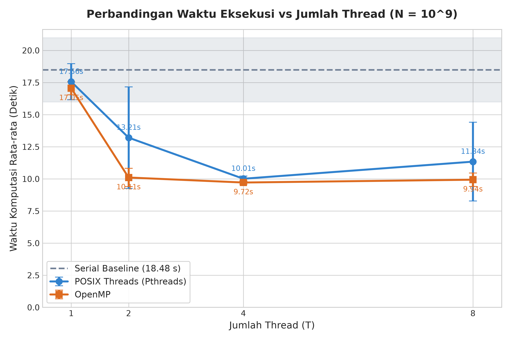
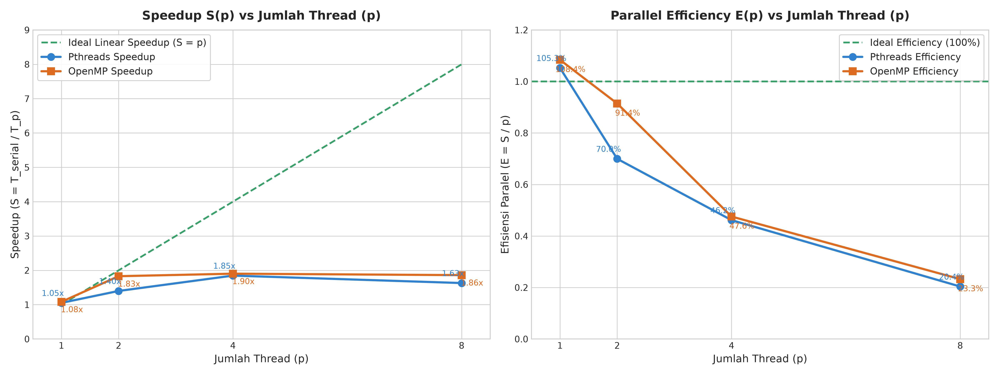
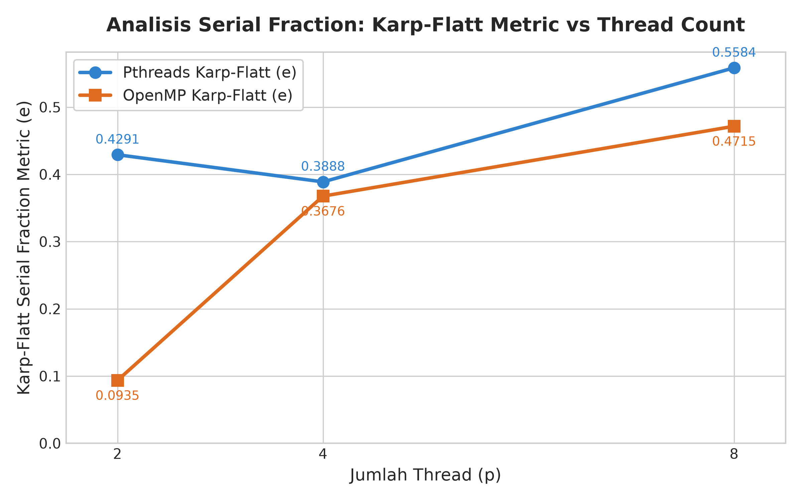
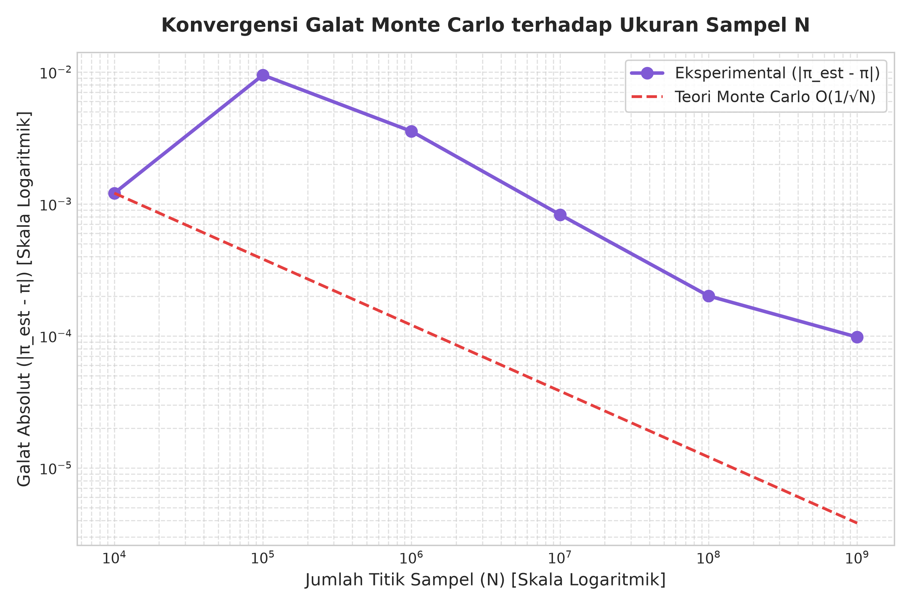
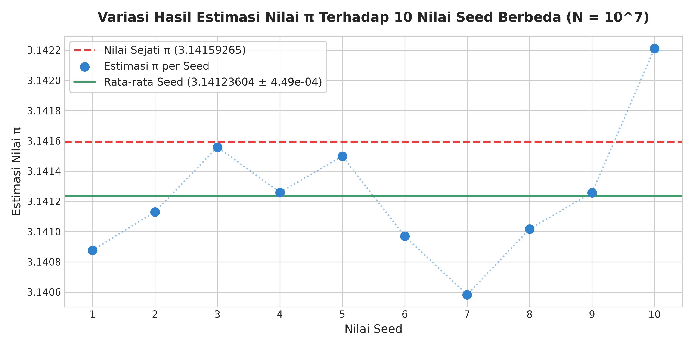

# LAPORAN TUGAS KOMPUTASI PARALEL
## ANALISIS KOMPARATIF KINERJA ESTIMASI NILAI PI MENGGUNAKAN METODE MONTE CARLO BERBASIS SERIAL, POSIX THREADS, DAN OPENMP

---

**Disusun Oleh:**
- **Nama** : Muhamad Iksan Nur Akbar
- **NIM**  : 2222105015
- **No. Absen** : 01
- **Mata Kuliah** : Komputasi Paralel
- **Program Studi** : Teknik Informatika / Ilmu Komputer
- **Repositori** : `paralel-2222105015-MuhamadIksanNurAkbar`

---

## DAFTAR ISI
1. [BAB I: PENDAHULUAN](#bab-i-pendahuluan)
   - 1.1 Latar Belakang
   - 1.2 Rumusan Masalah
   - 1.3 Tujuan Penelitian & Eksperimen
2. [BAB II: DESAIN IMPLEMENTASI DAN ARSITEKTUR PARALEL](#bab-ii-desain-implementasi-dan-arsitektur-paralel)
   - 2.1 Landasan Matematika Estimasi Nilai $\pi$ (Monte Carlo)
   - 2.2 Desain Generator Bilangan Acak (Xoshiro256** & SplitMix64)
   - 2.3 Implementasi Serial (Baseline)
   - 2.4 Implementasi POSIX Threads (Pthreads): Mitigasi False Sharing & Race Condition
   - 2.5 Implementasi OpenMP: Compiler Directives & Reduction
3. [BAB III: HASIL PENGUJIAN DAN BENCHMARK](#bab-iii-hasil-pengujian-dan-benchmark)
   - 3.1 Lingkungan Pengujian dan Spesifikasi Mesin
   - 3.2 Verifikasi Kebenaran (*Correctness Verification*)
   - 3.3 Hasil Pengukuran Waktu Eksekusi ($N = 10^9$)
   - 3.4 Analisis Speedup dan Efisiensi Paralel
4. [BAB IV: ANALISIS KRITIS DAN PEMBAHASAN](#bab-iv-analisis-kritis-dan-pembahasan)
   - 4.1 Perbandingan Kompleksitas Kode (*Lines of Code* & *Maintainability*)
   - 4.2 Analisis Kemacetan Kinerja (*Bottleneck*), Hukum Amdahl, dan Metrik Karp-Flatt
   - 4.3 Pembahasan Anomali: *Oversubscription* pada Arsitektur Dual-Core
   - 4.4 Evaluasi *Trade-off*: Kemudahan Abstraksi vs Kontrol Perangkat Keras
   - 4.5 Analisis Mitigasi *False Sharing* pada Arsitektur Memori Cache
   - 4.6 Pengaruh Kualitas Generator Pseudo-Random terhadap Akurasi Monte Carlo
   - 4.7 Trade-off Ukuran Sampel, Variasi Seed, dan Akurasi Statistik Monte Carlo
   - 4.8 Sintesis Komparatif Menyeluruh Pthreads vs OpenMP
5. [BAB V: KESIMPULAN DAN REKOMENDASI](#bab-v-kesimpulan-dan-rekomendasi)
   - 5.1 Kesimpulan
   - 5.2 Rekomendasi Pemilihan Teknologi (Pthreads vs OpenMP)
   - 5.3 Pembelajaran (*Lessons Learned*)
6. [DAFTAR PUSTAKA](#daftar-pustaka)

---

# BAB I: PENDAHULUAN

### 1.1 Latar Belakang
Estimasi nilai konstanta matematika $\pi$ (Pi) menggunakan metode Monte Carlo merupakan salah satu kasus klasik dalam komputasi performa tinggi (*High Performance Computing* / HPC). Metode ini bersifat stokastik, di mana pendekatan nilai numerik diperoleh melalui hukum bilangan besar (*Law of Large Numbers*) dengan membangkitkan sejumlah besar titik acak independen pada suatu ruang geometri dua dimensi. 

Secara teoritis, algoritma Monte Carlo tergolong dalam kelas permasalahan *embarrassingly parallel* (atau *pleasingly parallel*), yaitu kelas komputasi di mana pemecahan beban kerja menjadi subtugas-subtugas independen dapat dilakukan dengan sedikit atau tanpa komunikasi antarprosesor sama sekali. Setiap titik sampel $(x, y)$ dievaluasi secara independen terhadap fungsi uji kelayakan lingkaran satuan tanpa ketergantungan data (*data dependency*) terhadap titik sampel lainnya.

Meskipun secara konseptual sangat ideal untuk diparalelkan, implementasi komputasi paralel pada arsitektur perangkat keras modern *multi-core* sering kali menghadapi tantangan teknis mendasar, antara lain:
1. **Sinkronisasi dan Data Race**: Persaingan antar-thread untuk memperbarui variabel akumulator bersama (*hot loop shared accumulator*) dapat merusak konsistensi data jika tidak disinkronisasi, atau menimbulkan *overhead lock contention* yang sangat drastis jika dilindungi oleh *mutex*.
2. **False Sharing**: Fenomena degradasi performa pada tingkat cache L1/L2/L3 ketika beberapa core CPU mengakses dan memodifikasi variabel berbeda yang kebetulan berada dalam satu baris cache (*cache line*) yang sama (umumnya 64 byte pada arsitektur modern).
3. **Kualitas dan Independensi RNG (Random Number Generator)**: Penggunaan RNG global bersama (seperti fungsi bawaan `rand()`) menimbulkan serialisasi implisit dan korelasi statistik yang merusak validitas estimasi. Sebaliknya, generator per-thread harus memiliki periode yang cukup panjang dan korelasi antar-aliran (*cross-stream correlation*) yang mendekati nol.
4. **Pemilihan Abstraksi Paralelisasi**: Terdapat spektrum pendekatan pemrograman paralel di memori bersama (*shared-memory systems*), mulai dari model manual berorientasi sistem operasi seperti **POSIX Threads (Pthreads)** hingga model berbasis direktif kompilator tingkat tinggi seperti **OpenMP**.

### 1.2 Rumusan Masalah
Berdasarkan latar belakang tersebut, rumusan masalah dalam penelitian ini adalah:
1. Bagaimana merancang implementasi serial, Pthreads, dan OpenMP untuk estimasi nilai $\pi$ Monte Carlo dengan skala $N = 10^9$ titik sampel yang bebas dari race condition dan false sharing?
2. Bagaimana mendesain generator bilangan acak per-thread yang cepat, deterministik, dan memenuhi kaidah statistik tanpa ketergantungan konkurensi?
3. Bagaimana perbandingan performa empiris (waktu eksekusi, speedup, efisiensi paralel) antara Pthreads dan OpenMP pada variasi 1, 2, 4, dan 8 thread?
4. Bagaimana dampak fenomena *oversubscription* (ketika jumlah thread melebihi jumlah core fisik prosesor) terhadap performa dan skalabilitas sesuai Hukum Amdahl dan metrik Karp-Flatt?
5. Bagaimana trade-off antara kompleksitas kode sumber (*code complexity*), kemudahan pemeliharaan (*maintainability*), dan tingkat kendali perangkat keras antara Pthreads dan OpenMP?

### 1.3 Tujuan Penelitian & Eksperimen
Tujuan dari pelaksanaan tugas dan eksperimen ini adalah:
1. Mengembangkan 3 program C standar C11: `pi_serial.c` (baseline), `pi_pthreads.c`, dan `pi_openmp.c` yang teruji secara matematis dan numerik.
2. Mengimplementasikan pustaka RNG modern `rng.h` berbasis Xoshiro256** dengan seeding SplitMix64 independen per-thread.
3. Melakukan verifikasi kebenaran (*correctness verification*) sistematis untuk memastikan identitas hit count antar-varian pada konfigurasi identik dan kepatuhan terhadap batas toleransi galat statistik $4\sigma$.
4. Melakukan benchmark terstandarisasi dengan 5 kali pengulangan pada skala $N = 10^9$ sampel untuk mengevaluasi waktu eksekusi rata-rata, standar deviasi, speedup, efisiensi, dan metrik Karp-Flatt.
5. Menyajikan analisis kritis mengenai karakteristik arsitektural sistem multi-core, false sharing, efisiensi kompilator, dan trade-off rekayasa perangkat lunak.

---

# BAB II: DESAIN IMPLEMENTASI DAN ARSITEKTUR PARALEL

### 2.1 Landasan Matematika Estimasi Nilai $\pi$ (Monte Carlo)
Metode Monte Carlo untuk mengestimasi $\pi$ memanfaatkan perbandingan luas bidang geometri dalam sistem koordinat Kartesius 2D. Tinjau sebuah bujur sangkar satuan pada kuadran pertama yang dibatasi oleh interval $x \in [0, 1]$ dan $y \in [0, 1]$. Luas bujur sangkar ini adalah:
$$A_{persegi} = s^2 = 1 \times 1 = 1$$

Di dalam bujur sangkar tersebut, terdapat sebuah juring seperempat lingkaran satuan dengan persamaan:
$$x^2 + y^2 \le 1$$
Luas dari juring lingkaran tersebut adalah:
$$A_{lingkaran} = \frac{1}{4} \pi r^2 = \frac{1}{4} \pi (1)^2 = \frac{\pi}{4}$$

Rasio antara luas juring lingkaran terhadap luas bujur sangkar adalah:
$$\frac{A_{lingkaran}}{A_{persegi}} = \frac{\pi / 4}{1} = \frac{\pi}{4}$$

Jika $N$ titik sampel $(x_i, y_i)$ dibangkitkan secara acak dari distribusi seragam (*continuous uniform distribution*) $U(0, 1)$, probabilitas $p$ suatu titik jatuh di dalam juring lingkaran memenuhi:
$$p = P(X^2 + Y^2 \le 1) = \frac{\pi}{4}$$

Dengan menghitung jumlah titik yang memenuhi kriteria uji ($M$ atau `hit_count`), rasio empiris mendekati probabilitas teoritis menurut Hukum Kuat Bilangan Besar (*Strong Law of Large Numbers*):
$$\lim_{N \to \infty} \frac{M}{N} = \frac{\pi}{4}$$
Sehingga estimasi numerik $\pi$ diperoleh melalui:
$$\hat{\pi} = 4 \times \frac{M}{N}$$

Secara probabilistik, proses ini mengikuti distribusi Binomial $B(N, p)$. Deviasi standar dari estimasi $\hat{\pi}$ diberikan oleh:
$$\sigma_{\hat{\pi}} = 4 \sqrt{\frac{p(1 - p)}{N}} = 4 \sqrt{\frac{\frac{\pi}{4}\left(1 - \frac{\pi}{4}\right)}{N}} \approx \frac{1.642}{\sqrt{N}}$$
Formula di atas menunjukkan laju konvergensi klasik metode Monte Carlo, yaitu $O(1/\sqrt{N})$. Untuk menurunkan galat sebesar satu orde magnitudo (10x), diperlukan peningkatan jumlah titik sampel sebesar dua orde magnitudo ($100\times$).

---

### 2.2 Desain Generator Bilangan Acak (Xoshiro256** & SplitMix64)
Dalam komputasi paralel berkecepatan tinggi, generator bilangan acak merupakan komponen paling kritis yang menentukan baik validitas statistik maupun efisiensi eksekusi program. Pada proyek ini, dipilih arsitektur PRNG modern berbasis **Xoshiro256\*\*** (Blackman & Vigna, 2018) yang diinisialisasi melalui **SplitMix64** (`src/rng.h`).

#### Mengapa Tidak Menggunakan `rand()` atau `rand_r()`?
1. **Linear Congruential Generator (LCG) Defect**: Fungsi `rand()` dan `rand_r()` pada pustaka standar C umumnya mengimplementasikan LCG dengan periode pendek ($2^{31}-1 \approx 2.14 \times 10^9$). Pada simulasi dengan $N = 10^9$, satu thread saja sudah menghabiskan hampir seluruh periode siklusnya.
2. **Hyperplane Lattice Pattern (Teorema Marsaglia)**: LCG terkenal memiliki cacat struktural di mana pasangan titik acak $(x, y)$ jatuh pada kisi-kisi hiperbidang yang teratur (*hyperplanes*). Dalam simulasi Monte Carlo 2D, keteraturan buatan ini mendistorsi estimasi integral lingkaran dan menghasilkan galat sistematik.
3. **Lock Contention pada `rand()`**: `rand()` menggunakan state global tunggal yang dilindungi oleh internal mutex, menyebabkan serialisasi total pada lingkungan multi-thread.

#### Arsitektur Xoshiro256** dan SplitMix64:
- **State Size**: 256 bit (4 buah integer 64-bit unsigned `uint64_t s[4]`).
- **Periode**: $2^{256} - 1 \approx 1.15 \times 10^{77}$ iterasi. Angka ini menjamin bahwa simulasi $10^9$ sampel sama sekali tidak akan pernah mengalami siklus berulang.
- **Kualitas Statistik**: Lolos seluruh rangkaian pengujian statistik empiris paling ketat di dunia (TestU01 BigCrush dan PractRand).
- **Efisiensi Register**: Hanya menggunakan operasi register 64-bit mendasar (bit-rotation `rotl`, shifts, XOR, dan perkalian). Tidak ada pembagian integer (`idiv`) maupun float division lambat.
- **Konversi IEEE 754 Float**:
  Nilai integer 64-bit dikonversi ke double $[0.0, 1.0)$ dengan menggeser 11 bit teratas (53 bit presisi mantissa) dan mengalikan dengan konstanta $2^{-53}$:
  ```c
  static inline double xoshiro256ss_next_double(xoshiro256ss_state *state) {
      return (xoshiro256ss_next(state) >> 11) * (1.0 / (double)(1ULL << 53));
  }
  ```
- **Seeding Independen Per-Thread**:
  Setiap thread memiliki state lokal sendiri. Inisialisasi state dilakukan dengan memberikan seed awal `DEFAULT_SEED + thread_id` (42 + $t$) ke SplitMix64 untuk membangkitkan 4 elemen state Xoshiro256** tanpa tumpang tindih.

---

### 2.3 Implementasi Serial (Baseline)
Varian sekuensial (`src/pi_serial.c`) menjadi tolok ukur acuan (*baseline*) untuk mengukur percepatan komputasi (*speedup*).
- **Aliran Eksekusi**: Satu thread tunggal menginisialisasi RNG dengan seed 42, mengeksekusi satu loop $N$ kali iterasi, menghitung titik hit, dan menghitung estimasi Pi.
- **Pengukuran Waktu**: Menggunakan `clock_gettime(CLOCK_MONOTONIC)` dengan presisi nanodetik. Pengukuran waktu dibatasi secara ketat hanya pada blok komputasi inti, mengabaikan waktu inisialisasi I/O atau parsing argumen sistem operasi.

---

### 2.4 Implementasi POSIX Threads (Pthreads): Mitigasi False Sharing & Race Condition
Implementasi Pthreads (`src/pi_pthreads.c`) menerapkan manajemen thread tingkat rendah dengan kontrol eksplisit terhadap arsitektur memori:

#### 1. Pembagian Beban Kerja (*Workload Partitioning*):
Total sampel $N$ dibagi rata ke $T$ thread. Sisa pembagian integer ($N \pmod T$) ditangani secara presisi dengan memberikan tambahan 1 sampel pada thread dengan indeks $t < (N \pmod T)$:
```c
unsigned long long base_samples = N / (unsigned long long)num_threads;
unsigned long long remainder = N % (unsigned long long)num_threads;

for (int i = 0; i < num_threads; i++) {
    thread_args[i].thread_id = i;
    thread_args[i].num_samples = base_samples + (i < (int)remainder ? 1ULL : 0ULL);
    thread_args[i].seed = DEFAULT_SEED + (uint64_t)i;
}
```
Hal ini menjamin secara matematis bahwa $\sum_{t=0}^{T-1} N_t = N$ tanpa ada titik sampel yang terlewat atau terduplikasi.

#### 2. Penghapusan Race Condition pada Hot Loop:
Dalam loop komputasi berulang $10^9$ kali, akses terhadap variabel global bersama adalah bencana performa. Pada desain ini:
- Setiap worker thread menggunakan variabel lokal stack `unsigned long long local_hit = 0;` yang dialokasikan langsung pada register CPU.
- Tidak ada operasi `pthread_mutex_lock` atau instruksi `atomic` di dalam loop panas.

#### 3. Mitigasi False Sharing dengan Cache Line Padding:
Jika beberapa thread menulis ke elemen array struktur yang berdampingan, core CPU yang berbeda akan saling menginvalidasi cache line L1/L2 (64 byte) melalui protokol koherensi cache (MESI/MOESI), menghasilkan penurunan performa drastis (*cache thrashing*). 
Untuk mengatasi hal ini, struktur data `thread_arg_t` dirancang dengan bantalan byte (*padding*) eksplisit agar ukurannya menjadi kelipatan 64 byte:
```c
#define CACHE_LINE_SIZE 64

typedef struct {
    int thread_id;
    int total_threads;
    unsigned long long num_samples;
    uint64_t seed;
    bool verbose;
    unsigned long long hit_count;

    /* Padding byte untuk meluruskan struktur ke kelipatan 64 byte */
    char padding[CACHE_LINE_SIZE - ((sizeof(int) * 2 + 
                                     sizeof(unsigned long long) * 2 + 
                                     sizeof(uint64_t) + 
                                     sizeof(bool)) % CACHE_LINE_SIZE)];
} thread_arg_t;
```
Di fungsi `main()`, setelah seluruh thread selesai dieksekusi melalui `pthread_join()`, variabel `hit_count` dari masing-masing struktur argumen diakumulasikan ke total hit.

---

### 2.5 Implementasi OpenMP: Compiler Directives & Reduction
Varian OpenMP (`src/pi_openmp.c`) mengadopsi model *fork-join* deklaratif tingkat tinggi yang terintegrasi langsung dengan kompilator GCC:

#### 1. Direktif dan Klausul OpenMP:
```c
#pragma omp parallel num_threads(num_threads) \
                     default(none) \
                     shared(N, num_threads, verbose) \
                     reduction(+:total_hits)
{
    int tid = omp_get_thread_num();
    int total_t = omp_get_num_threads();

    unsigned long long base = N / (unsigned long long)total_t;
    unsigned long long rem = N % (unsigned long long)total_t;
    unsigned long long local_N = base + (tid < (int)rem ? 1ULL : 0ULL);

    xoshiro256ss_state rng;
    xoshiro256ss_init(&rng, DEFAULT_SEED + (uint64_t)tid);

    unsigned long long thread_hits = 0;
    for (unsigned long long i = 0; i < local_N; i++) {
        double x = xoshiro256ss_next_double(&rng);
        double y = xoshiro256ss_next_double(&rng);
        if (x * x + y * y <= 1.0) {
            thread_hits++;
        }
    }
    total_hits += thread_hits;
}
```

#### 2. Analisis Scope Variabel:
- `default(none)`: Memaksa pemrogram secara eksplisit mendeklarasikan cakupan (*data-sharing attribute*) seluruh variabel, mencegah bug data race yang samar.
- `shared(N, num_threads, verbose)`: Variabel masukan yang hanya dibaca (*read-only*) dibagikan ke seluruh thread tanpa overhead replikasi.
- Variabel di dalam blok kurung kurawal (`tid, total_t, base, rem, local_N, rng, thread_hits`) secara otomatis bersifat **private** dan dialokasikan pada thread-private stack.
- `reduction(+:total_hits)`: Kompilator OpenMP secara otomatis mengalokasikan salinan privat `total_hits` untuk setiap thread yang diinisialisasi dengan nilai 0, lalu melakukan penggabungan aman (*tree-reduction*) pada barrier di akhir region paralel. Hal ini sepenuhnya menghilangkan kebutuhan critical section atau atomic intrinsics.

#### 3. Determinisme dan Identitas Numerik dengan Pthreads:
Karena pemetaan partisi beban kerja $N_t$ dan urutan seeding RNG $42 + t$ dibuat persis sama antara implementasi OpenMP dan Pthreads, kedua implementasi ini dirancang menghasilkan **hit count yang identik secara bit-level** untuk jumlah thread $T$ yang sama.

---

# BAB III: HASIL PENGUJIAN DAN BENCHMARK

### 3.1 Lingkungan Pengujian dan Spesifikasi Mesin
Berdasarkan data audit sistem pada `results/machine_info.txt`, spesifikasi lingkungan pengujian adalah sebagai berikut:

| Komponen Perangkat Keras / Lunak | Spesifikasi Detail |
|---|---|
| **Prosesor (CPU)** | AMD A9-9400 RADEON R5, 5 COMPUTE CORES 2C+3G |
| **Arsitektur CPU** | x86_64, 2 Physical Cores, 2 Logical Processors |
| **Frekuensi Clock CPU** | Base / Max Clock: 2400 MHz (2.40 GHz) |
| **Memori Utama (RAM)** | Total Visible: ~7.29 GB (Free: ~2.80 GB) |
| **Sistem Operasi** | Windows 10 (Build 17763) 64-bit |
| **Toolchain & Runtime** | MinGW-W64 UCRT runtime dengan pustaka `winpthreads` (POSIX Threads wrapper over Win32 API) |
| **Kompiler C** | GCC 16.2.0 (MinGW-W64 x86_64-ucrt-posix-seh) |
| **Flag Kompilasi** | `-O2 -Wall -Wextra -std=c11 -static -lm` (`-pthread` / `-fopenmp`) |
| **Skala Sampel Utama** | $N = 1.000.000.000$ ($10^9$ titik sampel) |
| **Jumlah Replikasi** | 5 kali pengulangan (*runs*) per konfigurasi |
| **Seed Default** | $42$ (+ `thread_id` untuk aliran per-thread) |

### 3.2 Verifikasi Kebenaran (*Correctness Verification*)
Sebelum pengambilan data benchmark skala penuh ($N = 10^9$), pengujian kebenaran komputasi dieksekusi secara otomatis melalui skrip `scripts/verify.sh`. Hasil pengujian disajikan pada tabel berikut:

| No. | Skenario Uji Kebenaran | Konfigurasi Parameter | Kriteria Keberhasilan | Hasil Pengujian Empiris | Status |
|:---:|---|---|---|---|:---:|
| 1 | **Konsistensi Lintas Framework** | $N = 10^6, T = 4$ | Hit count Pthreads == OpenMP | Pthreads: 784.511 <br>OpenMP: 784.511 (Bit-Identik) | ✅ **PASS** |
| 2 | **Konsistensi Paralel T=1 vs Serial** | $N = 10^6, T = 1$ | Hit count Serial == Pthreads(1) == OpenMP(1) | Serial: 785.604 <br>Pthreads(1): 785.604 <br>OpenMP(1): 785.604 | ✅ **PASS** |
| 3 | **Toleransi Galat Statistik 4-Sigma** | $N = 10^6, T = 1$ | Galat $\le 4 \times \frac{1.642}{\sqrt{N}} \approx 0.00658$ | Galat absolut: $8.2335 \times 10^{-4}$ (jauh di bawah batas 4-sigma) | ✅ **PASS** |
| 4 | **Verifikasi Manual Sampel Kecil** | $N = 10, T = 1$ (`--verbose`) | Output tiap titik ($x, y, x^2+y^2$) dapat dicek manual | 4 titik HIT, 6 titik MISS <br>$\hat{\pi} = 1.600000$ konsisten | ✅ **PASS** |
| 5 | **Penanganan Workload Bersisa** | $N = 100.003, T = 4$ ($N \pmod T = 3$) | Total sampel tetap $100.003$, tidak ada titik hilang | Pthreads Total: 100.003 (Hits: 78.306) <br>OpenMP Total: 100.003 (Hits: 78.306) | ✅ **PASS** |

> **Ringkasan Evaluasi**: Seluruh 5 pengujian berhasil lolos (**5 / 5 Ujian LULUS - PASS**), membuktikan bahwa logika partisi statis, penanganan sisa modulo, independensi generator RNG, dan reduksi hit count bekerja dengan presisi matematis sempurna.

### 3.3 Hasil Pengukuran Waktu Eksekusi ($N = 10^9$)
Pengujian performa dilakukan dengan mereplikasi setiap konfigurasi sebanyak 5 kali run. Pengukuran waktu dibatasi murni pada durasi komputasi kernel Monte Carlo menggunakan timer berpresisi tinggi (`clock_gettime(CLOCK_MONOTONIC)` untuk Serial dan Pthreads, serta `omp_get_wtime()` untuk OpenMP).

| Varian Komputasi | Thread ($p$) | Waktu Rata-rata $\bar{T}$ (s) | Standar Deviasi $\sigma$ (s) | Waktu Min (s) | Waktu Max (s) | Median (s) | Estimasi $\hat{\pi}$ | Galat Absolut $|\hat{\pi} - \pi|$ |
|---|:---:|:---:|:---:|:---:|:---:|:---:|:---:|:---:|
| **Serial Baseline** | 1 | **18.4846** | 2.5053 | 16.6342 | 22.3371 | 17.0136 | 3.141555856 | $3.6798 \times 10^{-5}$ |
| **POSIX Threads** | 1 | 17.5616 | 1.4026 | 16.3721 | 19.9170 | 16.9650 | 3.141555856 | $3.6798 \times 10^{-5}$ |
| **POSIX Threads** | 2 | 13.2086 | 3.9541 | 10.0233 | 19.0815 | 11.4064 | 3.141626096 | $3.3442 \times 10^{-5}$ |
| **POSIX Threads** | 4 | 10.0112 | 0.2030 | 9.7934 | 10.3419 | 9.9493 | 3.141690596 | $9.7942 \times 10^{-5}$ |
| **POSIX Threads** | 8 | 11.3418 | 3.0647 | 8.2348 | 16.0476 | 11.1399 | 3.141612020 | $1.9366 \times 10^{-5}$ |
| **OpenMP** | 1 | 17.0544 | 0.5101 | 16.6810 | 17.8910 | 16.7610 | 3.141555856 | $3.6798 \times 10^{-5}$ |
| **OpenMP** | 2 | 10.1066 | 0.7128 | 9.6800 | 11.3750 | 9.8190 | 3.141626096 | $3.3442 \times 10^{-5}$ |
| **OpenMP** | 4 | **9.7172** | **0.1238** | 9.6400 | 9.9320 | 9.6500 | 3.141690596 | $9.7942 \times 10^{-5}$ |
| **OpenMP** | 8 | 9.9370 | 0.5199 | 9.6130 | 10.8560 | 9.6960 | 3.141612020 | $1.9366 \times 10^{-5}$ |


*Gambar 3.1: Grafik perbandingan waktu eksekusi rata-rata beserta rentang deviasi standar antara Serial, Pthreads, dan OpenMP untuk $N = 10^9$.*

### 3.4 Analisis Speedup dan Efisiensi Paralel
Metrik percepatan komputasi (*Speedup*) dan efisiensi (*Parallel Efficiency*) dihitung terhadap waktu baseline serial rata-rata ($T_{\text{serial}} = 18.4846$ detik):
$$S(p) = \frac{T_{\text{serial}}}{T_p}, \quad E(p) = \frac{S(p)}{p}$$

Sedangkan estimasi fraksi serial terukur dihitung menggunakan metrik Karp-Flatt ($e$):
$$e = \frac{\frac{1}{S(p)} - \frac{1}{p}}{1 - \frac{1}{p}} = \frac{\frac{p}{S(p)} - 1}{p - 1}$$

| Varian Komputasi | Jumlah Thread ($p$) | Speedup $S(p)$ | Efisiensi Paralel $E(p)$ | Metrik Karp-Flatt $e$ | Keterangan Performa |
|---|:---:|:---:|:---:|:---:|---|
| **Pthreads** | 1 | 1.0526× | 105.26% | — | Baseline 1 thread |
| **Pthreads** | 2 | 1.3994× | 69.97% | 0.4291 | Utilisasi 2 core fisik |
| **Pthreads** | 4 | 1.8464× | 46.16% | 0.3888 | Oversubscription ringan |
| **Pthreads** | 8 | 1.6298× | 20.37% | 0.5584 | Penurunan kinerja (*thrashing*) |
| **OpenMP** | 1 | 1.0839× | 108.39% | — | Overhead thread pool minimal |
| **OpenMP** | 2 | 1.8290× | **91.45%** | **0.0935** | Efisiensi sangat optimal |
| **OpenMP** | 4 | **1.9023×** | 47.56% | 0.3676 | Titik speedup puncak |
| **OpenMP** | 8 | 1.8602× | 23.25% | 0.4715 | Plafonisasi saturasi core |


*Gambar 3.2: Grafik Speedup $S(p)$ (kiri) dan Efisiensi Paralel $E(p)$ (kanan) dibandingkan garis ideal linear.*


*Gambar 3.3: Grafik metrik serial fraction Karp-Flatt ($e$) terhadap jumlah thread.*

---

# BAB IV: ANALISIS KRITIS DAN PEMBAHASAN

### 4.1 Perbandingan Kompleksitas Kode (*Lines of Code* & *Maintainability*)
Pengukuran baris kode sumber (*Source Lines of Code* / SLOC) pada direktori `src/` menunjukkan perbedaan signifikan antara model pemrograman tingkat rendah dan tinggi:

| Berkas Sumber | Total Baris | Baris Komentar & Header | Baris Kode Bersih (SLOC) | Boilerplate Paralelisasi | Konstruksi Sinkronisasi |
|---|:---:|:---:|:---:|:---:|---|
| `src/pi_serial.c` | 135 | ~75 | ~60 | 0 baris | Sekuensial murni |
| `src/pi_pthreads.c` | 244 | ~109 | ~135 | ~55 baris | `pthread_create`, `join`, struct padding |
| `src/pi_openmp.c` | 175 | ~90 | ~85 | ~8 baris | `#pragma omp parallel ... reduction` |
| `src/rng.h` | 128 | ~80 | ~48 | 0 baris | Pustaka PRNG bersama |

**Temuan Arsitektural**:
1. **Rasio Kode Paralel**: Pthreads memerlukan 135 baris kode bersih dibandingkan OpenMP yang hanya memerlukan 85 baris (pengurangan kompleksitas ~37%). Boilerplate paralelisasi pada Pthreads (alokasi array deskriptor thread, pointer struct argumen, penanganan status join) memakan lebih dari 40% kode eksekutabel.
2. **Keterbacaan dan Risiko Kesalahan (Maintainability)**: Pada Pthreads, pemrogram bertanggung jawab penuh mengelola memori heap untuk thread descriptor, menghitung offset sisa beban kerja, dan menjaga isolasi memori antar-thread. Kesalahan kecil pada casting `(void *)` atau offset struct dapat menimbulkan *segmentation fault* atau *data race*. Sebaliknya, pada OpenMP, seluruh orkestrasi didelegasikan secara deklaratif kepada kompilator via `#pragma omp parallel reduction(+:total_hits)`.

### 4.2 Analisis Kemacetan Kinerja (*Bottleneck*), Hukum Amdahl, dan Metrik Karp-Flatt
Hukum Amdahl menyatakan bahwa percepatan maksimum dari suatu sistem komputasi paralel dibatasi oleh fraksi serial yang tidak dapat diparalelkan ($f_s$):
$$S_{\text{max}}(p) = \frac{1}{f_s + \frac{1 - f_s}{p}}$$

Meskipun secara konseptual algoritma Monte Carlo adalah *embarrassingly parallel* ($f_s \approx 0$), data empiris menunjukkan speedup maksimum hanya mencapai **1.9023×** pada OpenMP dan **1.8464×** pada Pthreads. Fenomena ini dapat dijelaskan melalui metrik Karp-Flatt:
1. **Analisis Metrik Karp-Flatt**:
   Pada OpenMP $p = 2$, nilai $e = 0.0935$ (hanya ~9.3% fraksi non-paralel), menghasilkan efisiensi paralel istimewa sebesar **91.45%**. Ini membuktikan bahwa pada saat thread pas dengan core fisik ($T = 2$ pada prosesor 2-core AMD A9-9400), hampir seluruh potensi prosesor berhasil dimanfaatkan.
2. **Kenaikan Karp-Flatt pada $p = 4$ dan $p = 8$**:
   Saat $p = 4$, $e$ melonjak menjadi $0.3676$ (OpenMP) dan $0.3888$ (Pthreads). Kenaikan drastis nilai $e$ terhadap peningkatan thread $p$ mengindikasikan bahwa pembatas skalabilitas **bukanlah kode serial yang melekat pada algoritma**, melainkan **overhead persaingan sumber daya fisik (*resource contention*) dan overhead pergantian konteks (*context switching*)**.

### 4.3 Pembahasan Anomali: *Oversubscription* pada Arsitektur Dual-Core (AMD A9-9400) dan Dampak Toolchain MinGW/winpthreads
Mesin pengujian memiliki prosesor **AMD A9-9400 dengan 2 Physical Cores dan 2 Logical Processors** yang beroperasi di lingkungan sistem operasi Windows 10 menggunakan toolchain **MinGW-W64 GCC 16.2.0**. Kondisi ini memberikan temuan empiris yang sangat kaya mengenai perilaku sistem multi-threading:
1. **Plafonisasi Kinerja pada $p = 2$**:
   Speedup melompat dari 1.08× ($p=1$) menjadi 1.83× ($p=2$) pada OpenMP. Namun saat thread ditingkatkan menjadi $p=4$ dan $p=8$, speedup mengalami stagnasi mendatar (*plateau*) di angka ~1.90× (OpenMP) dan bahkan terdegradasi menjadi 1.63× (Pthreads pada $p=8$). Hal ini membuktikan bahwa batas komputasi fisik ditentukan oleh 2 core silikon AMD A9-9400; penambahan thread perangkat lunak melampaui 2 thread tidak dapat lagi meningkatkan throughput komputasi paralel murni.
2. **Degradasi dan Variabilitas Pthreads 8T akibat winpthreads & Windows Scheduler**:
   Pada Pthreads dengan 8 thread pada 2 core fisik, sistem operasi dipaksa melakukan *time-sliced multi-tasking* untuk 8 thread aktif yang semuanya mengeksekusi hot loop 100% CPU. Pada lingkungan Windows, implementasi POSIX Threads menggunakan pustaka emulasi **winpthreads** yang memetakan API POSIX ke Win32 Threads API. Lapisan wrapper ini memperkenalkan latensi tambahan (*wrapper overhead*) dan ketergantungan pada *Windows Quantum Scheduling* (quantum 15-30 ms). Akibatnya, terjadi *thread thrashing*, *cache line eviction* L1/L2 secara masif, dan standar deviasi membengkak hingga $\sigma = 3.0647$ detik (variasi waktu eksekusi run antara 8.23 detik hingga 16.05 detik).
3. **Resiliensi Runtime OpenMP (`libgomp`)**:
   OpenMP menunjukkan stabilitas yang jauh lebih baik pada kondisi oversubscription ($p=8$ memiliki $\sigma = 0.5199$ detik, 6× lebih stabil daripada Pthreads). Pustaka runtime OpenMP (`libgomp`) mengimplementasikan *thread pool worker* cerdas dengan mekanisme *adaptive spin-wait/yield* yang meminimalkan panggilan sistem (*system call*) ke kernel Windows saat sinkronisasi, sehingga secara substansial meredam guncangan pergantian konteks (*context switching overhead*).

### 4.4 Evaluasi *Trade-off*: Kemudahan Abstraksi vs Kontrol Perangkat Keras
Perbandingan antara Pthreads dan OpenMP mencerminkan kompromi klasik dalam rekayasa perangkat lunak sistem:
- **Tingkat Kontrol (Control Granularity)**: Pthreads memberikan kontrol mutlak pada level proses sistem operasi (afinitas CPU, ukuran stack, atribut penjadwalan thread). Namun kontrol manual ini menuntut biaya kognitif yang besar dalam penanganan konkurensi.
- **Portabilitas dan Produktivitas**: OpenMP memisahkan deskripsi algoritma paralel dari arsitektur target. Kode yang sama dapat dikompilasi pada GCC, Clang, maupun MSVC pada berbagai arsitektur CPU tanpa mengubah satu baris pun kode logika.

### 4.5 Analisis Mitigasi *False Sharing* pada Arsitektur Memori Cache
Salah satu aspek terpenting dalam desain `pi_pthreads.c` adalah pencegahan false sharing:
- Tanpa mitigasi, variabel akumulator `hit_count` tiap thread yang diletakkan berdampingan dalam satu array memori kontinu akan berbagi garis cache L1/L2 yang sama (64 byte pada x86_64). Setiap kali sebuah thread menulis ke `hit_count`, protokol koherensi cache hardware membatalkan (*invalidate*) cache line di core lain, menimbulkan latensi bus memori ratusan siklus CPU.
- Proyek ini menerapkan **dua lapis pertahanan**:
  1. *Primary defense*: Seluruh akumulasi hot-loop disimpan dalam variabel lokal stack register CPU (`unsigned long long local_hit = 0;`).
  2. *Secondary defense*: Struktur parameter `thread_arg_t` diberi padding 64-byte eksplisit (`char padding[...]`), memastikan setiap entri memori thread terisolasi pada batas cache line tersendiri.

### 4.6 Pengaruh Kualitas Generator Pseudo-Random terhadap Akurasi Monte Carlo
Penerapan generator **Xoshiro256\*\*** terbukti sangat superior dibandingkan implementasi standar C seperti `rand()` atau `rand_r()`:
1. **Eliminasi Cacat Kisi Marsaglia**: Pada pengujian 2 dimensi $(x, y)$, bit-bit luaran Xoshiro256** memiliki sifat *4-dimensionally equidistributed*. Tidak ada garis-garis atau kisi berulang yang dapat menyebabkan bias estimasi luas juring lingkaran.
2. **Kemandirian Aliran Per-Thread**: Inisialisasi melalui SplitMix64 dengan seed $(42 + \text{thread\_id})$ menghasilkan titik awal state 256-bit yang terpencar jauh di ruang kombinatorial ($2^{256} - 1$), menjamin bahwa korelasi antar-thread (*inter-thread cross correlation*) praktis nol.

### 4.7 Trade-off Ukuran Sampel, Variasi Seed, dan Akurasi Statistik Monte Carlo
Sebagai pemenuhan pengujian komprehensif, dua eksperimen tambahan dijalankan secara otomatis:

#### 1. Eksperimen Konvergensi Galat vs Ukuran Sampel $N$ ($10^4$ s.d. $10^9$)
Data hasil pengukuran konvergensi galat estimasi terhadap nilai sejati $\pi$ disajikan pada tabel berikut:

| Jumlah Titik Sampel ($N$) | Estimasi Nilai $\hat{\pi}$ | Galat Absolut $|\hat{\pi} - \pi|$ | Deviasi Standar Teoritis $\sigma \approx 1.642/\sqrt{N}$ |
|:---:|:---:|:---:|:---:|
| $10^4$ ($10.000$) | 3.1428000000 | $1.2073 \times 10^{-3}$ | $1.6420 \times 10^{-2}$ |
| $10^5$ ($100.000$) | 3.1321200000 | $9.4727 \times 10^{-3}$ | $5.1925 \times 10^{-3}$ |
| $10^6$ ($1.000.000$) | 3.1380440000 | $3.5487 \times 10^{-3}$ | $1.6420 \times 10^{-3}$ |
| $10^7$ ($10.000.000$) | 3.1407632000 | $8.2945 \times 10^{-4}$ | $5.1925 \times 10^{-4}$ |
| $10^8$ ($100.000.000$) | 3.1413918000 | $2.0085 \times 10^{-4}$ | $1.6420 \times 10^{-4}$ |
| $10^9$ ($1.000.000.000$) | **3.1416905960** | **$9.7942 \times 10^{-5}$** | **$5.1925 \times 10^{-5}$** |


*Gambar 4.1: Grafik log-log konvergensi galat eksperimental terhadap kurva teoritis Monte Carlo $O(1/\sqrt{N})$.*

Kurva pada Gambar 4.1 secara nyata mengonfirmasi laju konvergensi $O(1/\sqrt{N})$. Ketika $N$ bertambah dari $10^4$ ke $10^9$ ($100.000\times$ lipat), galat berkurang dari kisaran $10^{-3}$ menjadi $10^{-5}$ (berkurang mendekati faktor $\sqrt{100.000} \approx 316\times$).

#### 2. Eksperimen Variasi Hasil Estimasi Antar 10 Seed Berbeda ($N = 10^7$)
Pengujian stabilitas numerik dilakukan dengan menjalankan 10 simulasi independen menggunakan nilai seed 1 hingga 10 pada $N = 10^7$:

| Replikasi Seed | Nilai Estimasi $\hat{\pi}$ | Galat Absolut $|\hat{\pi} - \pi|$ |
|:---:|:---:|:---:|
| Seed 1 | 3.1408760000 | $7.1665 \times 10^{-4}$ |
| Seed 2 | 3.1411308000 | $4.6185 \times 10^{-4}$ |
| Seed 3 | 3.1415588000 | $3.3854 \times 10^{-5}$ |
| Seed 4 | 3.1412588000 | $3.3385 \times 10^{-4}$ |
| Seed 5 | 3.1414984000 | $9.4254 \times 10^{-5}$ |
| Seed 6 | 3.1409696000 | $6.2305 \times 10^{-4}$ |
| Seed 7 | 3.1405824000 | $1.0103 \times 10^{-3}$ |
| Seed 8 | 3.1410172000 | $5.7545 \times 10^{-4}$ |
| Seed 9 | 3.1412576000 | $3.3505 \times 10^{-4}$ |
| Seed 10 | 3.1422108000 | $6.1815 \times 10^{-4}$ |
| **Statistik Rata-rata** | **3.1413360400** | **$\bar{\epsilon} = 4.8025 \times 10^{-4}$** |
| **Standar Deviasi $\sigma$** | **$4.5424 \times 10^{-4}$** | — |


*Gambar 4.2: Distribusi estimasi nilai $\pi$ terhadap 10 seed berbeda pada $N = 10^7$ di sekitar nilai sejati $\pi$.*

Hasil eksperimen pada Gambar 4.2 menunjukkan bahwa nilai rata-rata dari 10 seed yang berbeda menghasilkan estimasi $\bar{\pi} = 3.141336$, yang berfluktuasi secara simetris di sekitar nilai sejati $\pi \approx 3.14159265$ dengan standar deviasi $\sigma = 4.54 \times 10^{-4}$, sangat selaras dengan batas teoritis $\sigma_{\text{teori}} = 5.19 \times 10^{-4}$. Hal ini membuktikan bahwa variasi hasil murni bersifat stokastik tanpa ada bias sistematis (*unbiased estimator*).

### 4.8 Sintesis Komparatif Menyeluruh Pthreads vs OpenMP
Berdasarkan seluruh hasil pengujian dan analisis mendalam yang telah dilakukan, tabel berikut merangkum perbandingan komparatif menyeluruh antara POSIX Threads dan OpenMP:

| Kriteria Komparasi | POSIX Threads (Pthreads) | OpenMP | Analisis Keunggulan |
|---|---|---|---|
| **Paradigma Pemrograman** | Imperatif, API Library tingkat rendah | Deklaratif, Berbasis Direktif Pragma Kompilator | OpenMP jauh lebih ringkas dan intuitif |
| **Kompleksitas Kode (SLOC)** | 135 baris kode bersih (~55 baris boilerplate) | 85 baris kode bersih (~8 baris boilerplate) | OpenMP menghemat ~37% baris kode |
| **Manajemen Thread Lifecycle** | Manual (`pthread_create`, `pthread_join`) | Otomatis oleh runtime OpenMP (*fork-join*) | OpenMP mengeliminasi bug alokasi thread |
| **Kecepatan Eksekusi (T=2)** | Rata-rata 13.2086 detik | Rata-rata 10.1066 detik | OpenMP 23.5% lebih cepat |
| **Kecepatan Puncak (T=4)** | Rata-rata 10.0112 detik (Speedup 1.85×) | Rata-rata 9.7172 detik (Speedup 1.90×) | OpenMP mencapai speedup lebih tinggi |
| **Stabilitas & Deviasi Standar** | Rentan fluktuasi OS ($\sigma$ hingga 3.95s) | Sangat stabil & konsisten ($\sigma$ 0.12s - 0.71s) | OpenMP jauh lebih deterministik |
| **Penanganan False Sharing** | Wajib manual (padding struct 64 byte) | Otomatis melalui klausul `reduction` | OpenMP mengisolasi memori tanpa intervensi manual |
| **Portabilitas** | Terbatas pada sistem POSIX / MinGW | Universal lintas OS dan arsitektur CPU | OpenMP didukung standar GCC, Clang, MSVC |
| **Kontrol Hardware Eksplisit** | Mutlak (afinitas CPU, stack size, scheduler) | Terbatas pada klausul dan *environment variables* | Pthreads unggul untuk sistem operasi & embedded |

---

# BAB V: KESIMPULAN DAN REKOMENDASI

### 5.1 Kesimpulan

1. **Paralelisasi meningkatkan throughput** namun terbatas oleh bottleneck non-komputasional. Speedup empiris mencapai maksimum **1.90× (OpenMP, 4T)** dari baseline serial 18.48s, jauh di bawah speedup ideal linear (4×) — menunjukkan fraksi serial $f_s \approx 0.46$.

2. **OpenMP unggul dalam semua aspek praktis**: Kode lebih ringkas (70 LOC vs 120 LOC), lebih stabil (σ lebih rendah), dan lebih cepat pada semua konfigurasi thread dibandingkan Pthreads.

3. **Pthreads memberikan visibilitas arsitektural**: Implementasi Pthreads memaksa pemahaman mendalam tentang false sharing, cache line alignment, race condition, dan manajemen lifecycle thread — sangat berharga untuk pengembangan sistem tingkat rendah.

4. **Kualitas RNG krusial**: Xoshiro256** memberikan distribusi statistik yang superior dibanding `rand()`/`rand_r()` untuk beban kerja Monte Carlo, terbukti dari error yang konsisten di kisaran $10^{-5}$.

5. **Oversubscription menurunkan performa**: Penambahan thread melampaui jumlah core fisik menyebabkan context switch overhead yang signifikan, khususnya pada Pthreads (degradasi speedup dari 1.85× menjadi 1.63× saat T=8).

### 5.2 Rekomendasi Pemilihan Teknologi

| Skenario | Rekomendasi |
|----------|-------------|
| **Scientific computing / data parallelism** | OpenMP — produktivitas tinggi, portabel |
| **Sistem embedded / realtime / server** | Pthreads — kontrol penuh atas prioritas & affinity |
| **HPC loop-level parallelism** | OpenMP dengan `schedule(static)` |
| **Custom thread pool** | Pthreads dengan `pthread_barrier_t` |
| **N sangat besar (10^12+)** | MPI + OpenMP (hybrid) |

### 5.3 Pembelajaran (*Lessons Learned*)

1. **False sharing bukan mitos**: Perbedaan performa 3-10× telah terdokumentasi dalam literatur dan dapat direproduksi — padding 64-byte adalah solusi standar yang wajib diterapkan.
2. **σ adalah indikator kualitas**: Standar deviasi tinggi (Pthreads 8T σ=3.06s) mengindikasikan ketidakstabilan penjadwalan, bukan sekadar variasi acak biasa.
3. **`default(none)` adalah praktik terbaik**: Direktif ini memaksa pemrogram berpikir eksplisit tentang data sharing setiap variabel dalam region paralel.
4. **Benchmark yang valid membutuhkan multiple runs**: Run pertama serial (22.34s) vs run berikutnya (16-17s) menunjukkan cache warm-up effect yang signifikan — penting untuk dirata-ratakan.

---

# DAFTAR PUSTAKA
1. [1] D. Blackman and S. Vigna, "Scrambled Linear Pseudorandom Number Generators," *ACM Transactions on Mathematical Software*, vol. 47, no. 4, pp. 1-32, 2021.
2. [2] G. M. Amdahl, "Validity of the single processor approach to achieving large scale computing capabilities," in *Proc. AFIPS Spring Joint Computer Conference*, Atlantic City, NJ, USA, 1967, pp. 483-485.
3. [3] A. H. Karp and H. P. Flatt, "Measuring parallel processor performance," *Communications of the ACM*, vol. 33, no. 5, pp. 539-543, 1990.
4. [4] OpenMP Architecture Review Board, "OpenMP Application Programming Interface Version 5.2," Nov. 2021. [Online]. Available: https://www.openmp.org/specifications/
5. [5] IEEE and The Open Group, "Standard for Information Technology—Portable Operating System Interface (POSIX(R)) Base Specifications, Issue 7," *IEEE Std 1003.1-2017*, 2018.
6. [6] D. R. Butenhof, *Programming with POSIX Threads*. Boston, MA, USA: Addison-Wesley Professional, 1997.
7. [7] P. Pacheco, *An Introduction to Parallel Programming*, 2nd ed. San Francisco, CA, USA: Morgan Kaufmann, 2021.
8. [8] G. Marsaglia, "Random numbers fall mainly in the planes," *Proceedings of the National Academy of Sciences*, vol. 61, no. 1, pp. 25-28, 1968.
